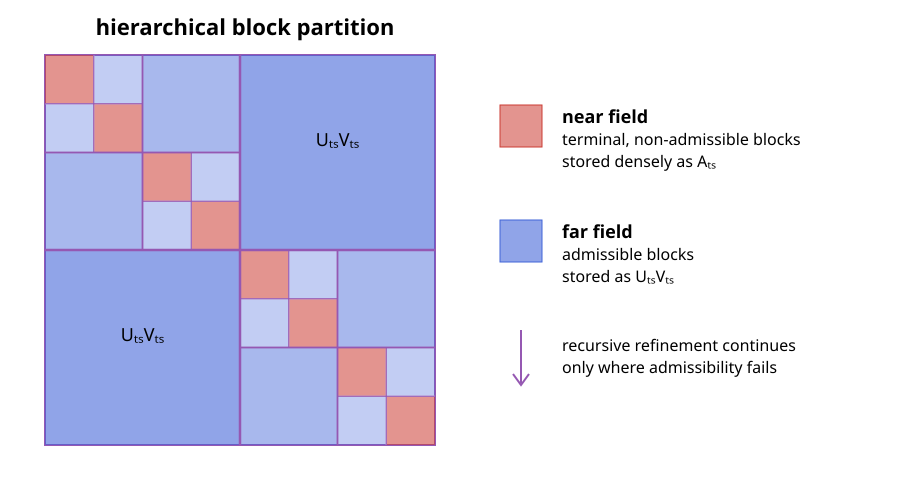

# Hierarchical Matrices

A hierarchical matrix, or $\mathcal{H}$-matrix, represents a dense matrix by a
hierarchy of small dense near-field blocks and low-rank far-field blocks. For
matrices arising from integral equations, this reflects the different behavior of
the kernel at short and long distances: nearby interactions may be singular or
rapidly varying, whereas well-separated interactions are usually smooth and
compressible [[1, 3, 6]](@ref refs).

## Cluster Trees and Block Trees

Let

```math
\boldsymbol{\mathsf A}\in\mathbb{K}^{M\times N},
\qquad
\mathcal I=\{1,\ldots,M\},
\quad
\mathcal J=\{1,\ldots,N\}.
```

A cluster tree $\mathcal T_{\mathcal I}$ recursively partitions the row-index set.
Its root is $\mathcal I$, and the children of every non-leaf cluster $t$ form a
disjoint partition of $t$. A second tree $\mathcal T_{\mathcal J}$ organizes the
column indices in the same way. Each cluster is associated with a geometrical
support $\Omega_t$ containing the positions of its degrees of freedom.

The Cartesian product of the two cluster trees defines a block tree. A block
$b=t\times s$ represents the submatrix

```math
\boldsymbol{\mathsf A}_{ts}
=\boldsymbol{\mathsf A}[t,s]
\in\mathbb{K}^{|t|\times|s|}.
```

Starting with $\mathcal I\times\mathcal J$, the block tree recursively subdivides
cluster pairs until they are either geometrically admissible or cannot be refined
further. Its leaves form a disjoint matrix partition

```math
\mathcal P
=\mathcal P_{\mathrm{near}}\mathbin{\dot\cup}
 \mathcal P_{\mathrm{far}}.
```

## Geometric Admissibility

A strong admissibility condition declares $t\times s$ a far-field block when

```math
\max\!\left(
\operatorname{diam}(\Omega_t),
\operatorname{diam}(\Omega_s)
\right)
\leq
\eta\,\operatorname{dist}(\Omega_t,\Omega_s).
```

The condition compares the size of both clusters with their separation. In the
H2Trees backend, the supports are bounding balls or boxes, and the distance is the
gap between them. With the convention above, increasing $\eta$ makes the test
easier to satisfy: more blocks enter the far field, including less strongly
separated interactions that may require a larger numerical rank.

If a pair is not admissible, it is subdivided. A non-admissible pair that reaches a
terminal cluster becomes a near-field block and is stored densely. The resulting
recursive structure is illustrated below; the exact pattern depends on the
geometry rather than only on the matrix indices.



## Blockwise Low-Rank Approximation

For a block partition $\mathcal P$ and maximum far-field rank $k$, the associated
hierarchical matrix class is

```math
\mathcal H(\mathcal P,k)
=
\left\{
\boldsymbol{\mathsf M}\in\mathbb{K}^{M\times N}:
\operatorname{rank}(\boldsymbol{\mathsf M}[t,s])\leq k
\ \text{for all}\ t\times s\in\mathcal P_{\mathrm{far}}
\right\}.
```

No rank restriction is imposed on the near-field blocks [[1]](@ref refs).
For every far-field block $t\times s\in\mathcal P_{\mathrm{far}}$, seek factors

```math
\boldsymbol{\mathsf A}_{ts}
\approx
\widetilde{\boldsymbol{\mathsf A}}_{ts}
=
\boldsymbol{\mathsf U}_{ts}\boldsymbol{\mathsf V}_{ts},
```

where

```math
\boldsymbol{\mathsf U}_{ts}\in\mathbb{K}^{|t|\times k_{ts}},
\qquad
\boldsymbol{\mathsf V}_{ts}\in\mathbb{K}^{k_{ts}\times|s|},
\qquad
k_{ts}\ll\min(|t|,|s|).
```

Near-field blocks are retained without compression. The complete approximation is
therefore defined blockwise by

```math
\widetilde{\boldsymbol{\mathsf A}}[t,s]
=
\begin{cases}
\boldsymbol{\mathsf A}_{ts},
&t\times s\in\mathcal P_{\mathrm{near}},\\[2mm]
\boldsymbol{\mathsf U}_{ts}\boldsymbol{\mathsf V}_{ts},
&t\times s\in\mathcal P_{\mathrm{far}}.
\end{cases}
```

An $\mathcal H$-matrix stores independent factors for its admissible blocks; a
cluster appearing in several blocks does not share a basis between them.

## Construction with ACA

ACA constructs $\boldsymbol{\mathsf U}_{ts}$ and
$\boldsymbol{\mathsf V}_{ts}$ from selected rows and columns of each far-field
block. It does not first assemble the dense matrix
$\boldsymbol{\mathsf A}_{ts}$ [[1, 3]](@ref refs). For a block of size
$m_t\times n_s$ compressed to rank $k_{ts}$, the factors contain

```math
k_{ts}(m_t+n_s)
```

scalars. Partial-pivoted ACA evaluates the same order of matrix entries and needs
$\mathcal O(k_{ts}^2(m_t+n_s))$ arithmetic operations. This on-demand access is
especially important in boundary-element methods, where a single matrix entry may
itself require numerical quadrature.

The dense near field and the compressed far field are assembled independently:

```text
row and column cluster trees
              │
              ▼
       block-tree traversal
              │
       admissibility test
        ┌─────┴─────┐
        ▼           ▼
  terminal near   admissible far
  dense assembly  ACA compression
        └─────┬─────┘
              ▼
        H-matrix operator
```

## Integral-Equation Matrices

After a boundary-element or method-of-moments discretization, an integral operator
produces a dense system matrix with entries of the form

```math
A_{ij}=a(\boldsymbol\beta_i,\boldsymbol\alpha_j),
```

where $\boldsymbol\beta_i$ and $\boldsymbol\alpha_j$ are testing and basis
functions. Geometric separation removes the kernel singularity from far-field
blocks and makes their interactions amenable to low-rank approximation. This is
the setting in which ACA replaces the quadratic storage and application cost of a
dense method-of-moments matrix [[3]](@ref refs).

Admissibility alone does not guarantee that a particular ACA pivot sequence detects
the numerical rank reliably. Double-layer operators, including the magnetic-field
integral operator, can contain separated algebraic structures that partial
pivoting does not visit before the standard convergence estimate becomes small
[[6]](@ref refs). Such blocks remain geometrically compressible, but require the
combined maximum-value/random-sampling strategy described in
[Robust ACA for Integral Equations](../manual/aca.md#Robust-ACA-for-Integral-Equations).
Thus,
geometric admissibility and algebraic pivot reliability address different parts of
the construction.

## Storage and Matrix-Vector Products

Ignoring index and object overhead, the number of stored scalars is

```math
N_{\mathrm{storage}}
=
\sum_{t\times s\in\mathcal P_{\mathrm{near}}}|t|\,|s|
+
\sum_{t\times s\in\mathcal P_{\mathrm{far}}}
k_{ts}(|t|+|s|).
```

The same expression describes the leading work of a matrix-vector product. A
dense near-field block contributes
$\boldsymbol{\mathsf A}_{ts}\boldsymbol x_s$, whereas a far-field block is applied
as

```math
\boldsymbol{\mathsf U}_{ts}
\left(\boldsymbol{\mathsf V}_{ts}\boldsymbol x_s\right).
```

The inner product first reduces $\boldsymbol x_s$ to $k_{ts}$ coefficients, and
the outer product maps them to the row cluster. Neither the dense far-field block
nor the complete dense matrix is formed.

## Symmetric H-Matrices

For a transpose-symmetric operator on one index space, the row and column cluster
trees can be shared. A symmetric admissibility predicate gives matching near and
far classifications for each pair of opposite blocks. Each unordered
off-diagonal pair then needs only one stored block or set of low-rank factors:
the opposite block is its transpose. For complex matrices, no conjugation is
applied.

A stored off-diagonal near block contributes to both row clusters:

```math
\boldsymbol y_t \mathrel{+}= \boldsymbol{\mathsf A}_{ts}\boldsymbol x_s,
\qquad
\boldsymbol y_s \mathrel{+}= \boldsymbol{\mathsf A}_{ts}^{\mathsf T}\boldsymbol x_t.
```

Far-field factors are shared in the same way. Diagonal near blocks remain full
dense blocks. For an all-near matrix of order $N$, the stored numerical payload
is $(N^2+d)/2$, where $d$ counts the entries in those diagonal blocks. Index and
workspace storage is additional, and matrix-vector products still apply both
orientations of every off-diagonal block.

The [single-space assembly interface](@ref symmetric-hmatrix-assembly) selects
this representation explicitly; passing the same space twice selects general
assembly.

## Accuracy

Because the leaf blocks form a disjoint partition and the near field is assembled
exactly with respect to the chosen quadrature,

```math
\left\lVert
\boldsymbol{\mathsf A}-\widetilde{\boldsymbol{\mathsf A}}
\right\rVert_{\mathrm F}^2
=
\sum_{t\times s\in\mathcal P_{\mathrm{far}}}
\left\lVert
\boldsymbol{\mathsf A}_{ts}
-\boldsymbol{\mathsf U}_{ts}\boldsymbol{\mathsf V}_{ts}
\right\rVert_{\mathrm F}^2.
```

If every far-field block satisfied the exact relative condition

```math
\left\lVert
\boldsymbol{\mathsf A}_{ts}
-\boldsymbol{\mathsf U}_{ts}\boldsymbol{\mathsf V}_{ts}
\right\rVert_{\mathrm F}
\leq
\varepsilon
\lVert\boldsymbol{\mathsf A}_{ts}\rVert_{\mathrm F},
```

then the global Frobenius error would obey the same relative bound. In practice,
ACA uses an estimated convergence criterion, so the requested tolerance is not an
a priori error guarantee. Pivoting, random sampling, admissibility, and the maximum
rank all influence the attained error. Quadrature and discretization errors are
separate from the $\mathcal H$-matrix compression error.

## Complexity and the Relation to H2-Matrices

For balanced cluster trees, bounded far-field rank $k$, bounded near-field
connectivity, and a uniformly sparse block tree, the storage and matrix-vector
cost are

```math
\mathcal O(kN\log N),
```

instead of $\mathcal O(N^2)$ for a dense matrix [[1, 3]](@ref refs). The logarithm
arises because an ordinary $\mathcal H$-matrix stores separate block bases across
the levels of the tree. A stricter separation requirement usually lowers the ranks
but leaves more dense near-field interactions; a more permissive requirement does
the reverse.

An $\mathcal H^2$-matrix replaces the independent block bases by nested bases
shared by all interactions of a cluster. Under fixed-rank assumptions this removes
the logarithmic factor and gives $\mathcal O(kN)$ storage and application cost
[[5, 7]](@ref refs). The incomplete ACA develops the pivot sets needed for that
nested construction; see
[Incomplete Adaptive Cross Approximation](iaca.md).

The stated bounds rely on bounded ranks and regular tree geometry. High-frequency
problems, strongly nonuniform meshes, or unsuitable admissibility parameters can
make the ranks or the number of blocks grow and must be analyzed separately.

## Hierarchical Arithmetic

The set $\mathcal H(\mathcal P,k)$ is not closed under the matrix operations. A
sum of two rank-$k$ blocks has rank up to $2k$, and a product accumulates
contributions from every inner cluster. Hierarchical arithmetic therefore
works with *truncated* operations: every result block is projected back to low
rank by a truncation operator $\mathcal T_\varepsilon$, and the partition of the
result is fixed in advance [[8, 9]](@ref refs). With this approximation in
every step, sums, products and the LU factorization cost almost linear time
and storage.

All arithmetic in this package truncates to the tolerance $\varepsilon$ chosen
at assembly. It is stored with the matrix, and an operation on matrices with
different tolerances uses the largest one. Sums require the same cluster trees
and partitions. Products require matching cluster trees, but the partitions of
the operands may differ.

### Truncation

Let $\boldsymbol{\mathsf R}=\boldsymbol{\mathsf U}\boldsymbol{\mathsf V}$ be a
block of size $m\times n$ given by factors of rank $r$, for example the
stacked factors of a sum. A reduced QR decomposition of the left factor and an
LQ decomposition of the right factor,

```math
\boldsymbol{\mathsf U}=\boldsymbol{\mathsf Q}_U\boldsymbol{\mathsf R}_U,
\qquad
\boldsymbol{\mathsf V}=\boldsymbol{\mathsf L}_V\boldsymbol{\mathsf Q}_V,
```

reduce the singular value decomposition of $\boldsymbol{\mathsf R}$ to that of
the small core
$\boldsymbol{\mathsf R}_U\boldsymbol{\mathsf L}_V
=\widehat{\boldsymbol{\mathsf U}}\boldsymbol\Sigma\widehat{\boldsymbol{\mathsf V}}^{\mathsf H}
\in\mathbb K^{r\times r}$. The truncated rank is the smallest $k$ with

```math
\sigma_{k+1}\leq\varepsilon\,\sigma_1,
```

and the new factors are
$\boldsymbol{\mathsf Q}_U\widehat{\boldsymbol{\mathsf U}}_k\boldsymbol\Sigma_k$ and
$\widehat{\boldsymbol{\mathsf V}}_k^{\mathsf H}\boldsymbol{\mathsf Q}_V$. By the
Eckart--Young theorem, this is the best rank-$k$ approximation, with spectral
error $\sigma_{k+1}$. The error is therefore controlled blockwise, relative to
the spectral norm $\sigma_1$ of each block. The cost is
$\mathcal O(r^2(m+n)+r^3)$.

ACA stops on an estimate and does not produce optimal ranks. Truncating every
far-field block of an assembled matrix (`recompress!`) usually lowers the ranks
and the cost of all later operations.

### Addition

For matrices with the same partition, dense blocks are added exactly. A sum of
low-rank blocks is formed by stacking the factors,

```math
\boldsymbol{\mathsf U}_C\boldsymbol{\mathsf V}_C
+\alpha\,\boldsymbol{\mathsf U}_A\boldsymbol{\mathsf V}_A
=
\begin{bmatrix}\boldsymbol{\mathsf U}_C & \alpha\boldsymbol{\mathsf U}_A\end{bmatrix}
\begin{bmatrix}\boldsymbol{\mathsf V}_C\\ \boldsymbol{\mathsf V}_A\end{bmatrix},
```

which has rank at most $r_C+r_A$ and is truncated once. All blocks are
independent.

### Multiplication

The product $\boldsymbol{\mathsf C}\leftarrow\boldsymbol{\mathsf C}
+\alpha\boldsymbol{\mathsf A}\boldsymbol{\mathsf B}$ requires that the column
cluster tree of $\boldsymbol{\mathsf A}$ is the row cluster tree of
$\boldsymbol{\mathsf B}$. A terminal block $t\times s$ of $\boldsymbol{\mathsf C}$
receives

```math
\boldsymbol{\mathsf C}_{ts}\leftarrow\boldsymbol{\mathsf C}_{ts}
+\alpha\sum_{\rho}\boldsymbol{\mathsf A}[t,\rho]\,\boldsymbol{\mathsf B}[\rho,s],
```

where $\rho$ runs over the inner clusters of the terminal blocks of
$\boldsymbol{\mathsf A}$ and $\boldsymbol{\mathsf B}$ that meet $t$ and $s$. The
classical algorithm descends the three block trees recursively and truncates
after every contribution [[8, 9]](@ref refs). This package keeps the recursive
structure, but organizes the work per destination block and reduces the number
of truncations:

- **Low-rank terms.** If $\boldsymbol{\mathsf A}[t,\rho]=\boldsymbol{\mathsf U}
  \boldsymbol{\mathsf V}$ is low rank, its contribution
  $\boldsymbol{\mathsf U}\,(\boldsymbol{\mathsf V}\boldsymbol{\mathsf B}[\rho,s])$
  needs one product of the whole hierarchical panel
  $\boldsymbol{\mathsf B}[\rho,s]$ with $r$ vectors, whatever its partition.
  The cost is $r$ times the storage of the panel, and the term has rank $r$. A
  low-rank block of $\boldsymbol{\mathsf B}$ is treated in the same way.
- **Dense terms.** A product of two dense blocks with inner dimension $|\rho|$
  enters as an exact term of rank $|\rho|$. Once the dense terms of an
  $m\times n$ destination reach a total rank of $mn/(m+n)$, they are summed
  into a dense $m\times n$ core instead, which then requires less storage.
- **Accumulated updates.** The terms of a destination are collected as stacked
  factors and truncated together with the destination: once, or in batches of
  a bounded number of columns. This replaces one truncation per contribution
  by a single one.
- **Shared terms.** A low-rank block of $\boldsymbol{\mathsf A}$ on a coarse row
  cluster $\tau\supsetneq t$ contributes to every destination below $\tau$. Its
  product is formed and truncated once on a virtual block above these
  destinations, and each destination receives its slice.
- **Implicit products.** For a far-field destination with many contributions,
  it can be cheaper to truncate the operator
  $\boldsymbol{\mathsf C}_{ts}+\alpha\boldsymbol{\mathsf A}[t,:]\,
  \boldsymbol{\mathsf B}[:,s]$ directly from its products with vectors,
  without forming the terms. A cost model chooses this when the plan is built.

Wide accumulated sums and implicit products are truncated with the adaptive
randomized range finder [[11]](@ref refs). Products with Gaussian vectors
$\boldsymbol\omega_i$ build an orthonormal basis $\boldsymbol{\mathsf Q}$ of the
range of the operator $\boldsymbol{\mathsf S}$. Blocks of $p$ further samples
certify the a posteriori bound

```math
\left\lVert(\boldsymbol{\mathsf I}-\boldsymbol{\mathsf Q}\boldsymbol{\mathsf Q}^{\mathsf H})
\boldsymbol{\mathsf S}\right\rVert_2
\leq 10\sqrt{2/\pi}\,\max_{i=1,\ldots,p}
\left\lVert(\boldsymbol{\mathsf I}-\boldsymbol{\mathsf Q}\boldsymbol{\mathsf Q}^{\mathsf H})
\boldsymbol{\mathsf S}\boldsymbol\omega_i\right\rVert_2
```

with probability at least $1-10^{-p}$; here $p=8$. Samples that fail the test
extend the basis. Once the bound is below a tenth of the tolerance, the small
matrix $\boldsymbol{\mathsf Q}^{\mathsf H}\boldsymbol{\mathsf S}$ is truncated
by an SVD, and the range-finder error is charged against the tolerance. The cost
grows with the rank of the result instead of the number of stacked columns. The
random numbers have a fixed seed, so results are reproducible.

### LU Factorization

The LU factorization follows the cluster tree [[8, 10]](@ref refs). For a
cluster with children $\tau_1,\tau_2$, write

```math
\boldsymbol{\mathsf A}=
\begin{bmatrix}
\boldsymbol{\mathsf A}_{11} & \boldsymbol{\mathsf A}_{12}\\
\boldsymbol{\mathsf A}_{21} & \boldsymbol{\mathsf A}_{22}
\end{bmatrix}
=
\begin{bmatrix}
\boldsymbol{\mathsf L}_{11} & \\
\boldsymbol{\mathsf L}_{21} & \boldsymbol{\mathsf L}_{22}
\end{bmatrix}
\begin{bmatrix}
\boldsymbol{\mathsf U}_{11} & \boldsymbol{\mathsf U}_{12}\\
 & \boldsymbol{\mathsf U}_{22}
\end{bmatrix}.
```

The factorization proceeds in four steps:

1. Factorize $\boldsymbol{\mathsf A}_{11}=\boldsymbol{\mathsf L}_{11}
   \boldsymbol{\mathsf U}_{11}$ recursively.
2. Solve $\boldsymbol{\mathsf U}_{12}=\boldsymbol{\mathsf L}_{11}^{-1}
   \boldsymbol{\mathsf A}_{12}$ and
   $\boldsymbol{\mathsf L}_{21}=\boldsymbol{\mathsf A}_{21}
   \boldsymbol{\mathsf U}_{11}^{-1}$.
3. Update the Schur complement $\boldsymbol{\mathsf A}_{22}\leftarrow
   \boldsymbol{\mathsf A}_{22}-\boldsymbol{\mathsf L}_{21}\boldsymbol{\mathsf U}_{12}$
   with a truncated product.
4. Factorize the updated $\boldsymbol{\mathsf A}_{22}$ recursively.

A cluster with more children eliminates them one after another. The diagonal
leaves are dense and are factorized by LAPACK with partial pivoting. Pivoting
is restricted to each leaf, so the result is

```math
\boldsymbol{\mathsf P}\boldsymbol{\mathsf A}\approx
\boldsymbol{\mathsf L}\boldsymbol{\mathsf U},
```

with a block-diagonal permutation $\boldsymbol{\mathsf P}$ of the leaf
permutations. Rows of other leaves cannot be used as pivots, so a leaf that is
singular on its own cannot be factorized. The factors overwrite the blocks of
the matrix and have its partition.

The triangular solves in step 2 have hierarchical right-hand sides. They are
block forward or backward substitutions over the terminal blocks of
$\boldsymbol{\mathsf A}_{12}$ (or $\boldsymbol{\mathsf A}_{21}$). Each block
first subtracts its products with the blocks solved before it, which is a
truncated product, then solves with the diagonal factor of its cluster. For a
low-rank block, only one factor changes:

```math
\boldsymbol{\mathsf L}^{-1}(\boldsymbol{\mathsf U}\boldsymbol{\mathsf V})
=(\boldsymbol{\mathsf L}^{-1}\boldsymbol{\mathsf U})\boldsymbol{\mathsf V},
\qquad
(\boldsymbol{\mathsf U}\boldsymbol{\mathsf V})\,\boldsymbol{\mathsf U}_{11}^{-1}
=\boldsymbol{\mathsf U}(\boldsymbol{\mathsf V}\boldsymbol{\mathsf U}_{11}^{-1}),
```

so the solve itself needs no truncation.

A solve with dense right-hand sides applies the leaf permutations and then a
forward and a backward substitution. Their leaves use dense triangular solves,
and the off-diagonal blocks are applied as matrix products. The cost is
proportional to the storage of the factors times the number of right-hand
sides. Transposed systems use
$\boldsymbol{\mathsf A}^{\mathsf T}=\boldsymbol{\mathsf U}^{\mathsf T}
\boldsymbol{\mathsf L}^{\mathsf T}\boldsymbol{\mathsf P}$, and adjoint systems
the conjugated transposed solve.

### Accuracy and Complexity

Every truncation commits a blockwise relative error of at most $\varepsilon$ in
the spectral norm, but the errors of the many truncations of a product or a
factorization accumulate. The requested tolerance is therefore no a priori
bound for the error of the result. With a small $\varepsilon$, the LU
factorization serves as a direct solver. With a coarse one, it is a cheap and
often effective preconditioner for an iterative solver.

For balanced cluster trees, a uniformly sparse block tree and bounded ranks
$k$, the truncated sum costs $\mathcal O(k^2N\log N)$, and the product and the
LU factorization $\mathcal O(k^2N\log^2N)$ [[9]](@ref refs). As for assembly,
the ranks needed for a fixed tolerance grow with the frequency of oscillatory
kernels.

### Parallel Execution

The operations decompose into block operations: leaf factorizations, triangular
solve steps, the products of virtual blocks and the updates of destination
blocks. Each block operation declares the blocks it reads and writes. In
serial program order, an operation depends on the last earlier writer of every
block it uses and on the earlier readers of every block it writes. Any execution
order that respects these dependencies computes exactly the serial result.
Tasks therefore run block operations as soon as their inputs are final, in the
spirit of the task-based $\mathcal H$-LU of [[12]](@ref refs), and the results
are identical for every number of tasks. Sums, recompression and matrix-vector
products consist of independent pieces; they are split into chunks of balanced
cost.

For constructors, point-kernel examples, tree backends, and matrix operations, see
[Using Hierarchical Matrices](../manual/hmatrix.md).
